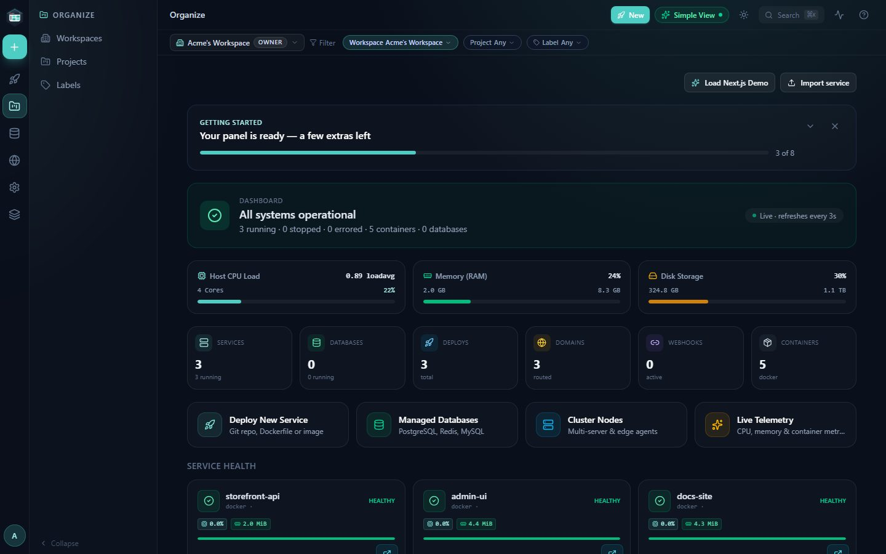
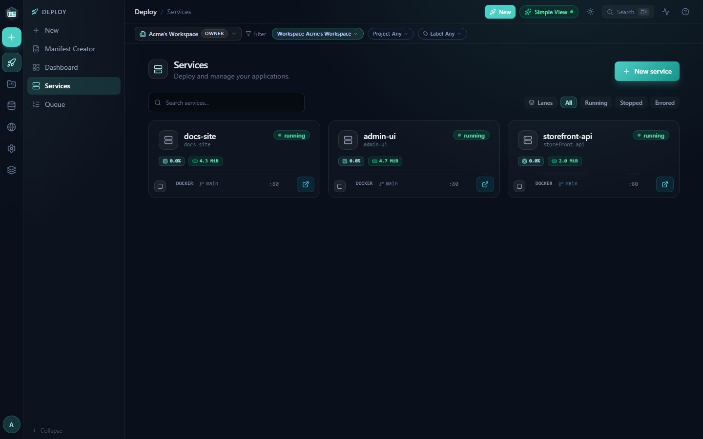
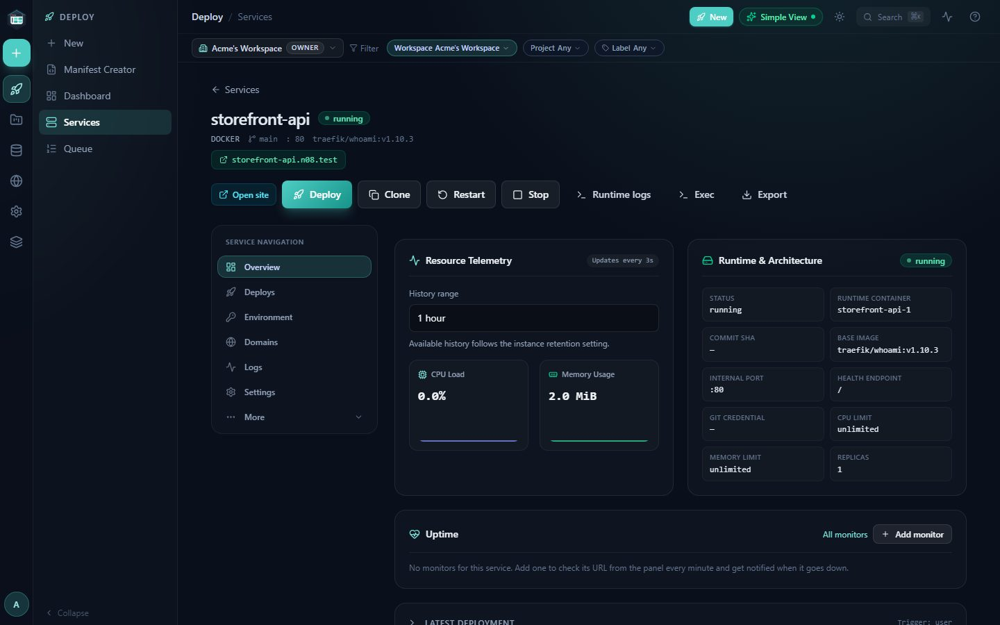
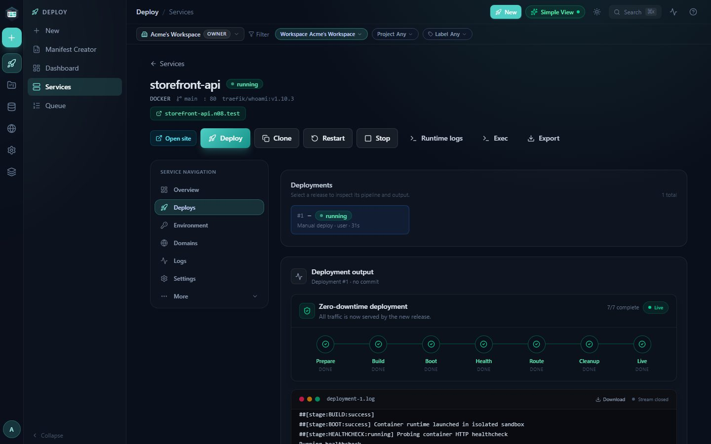
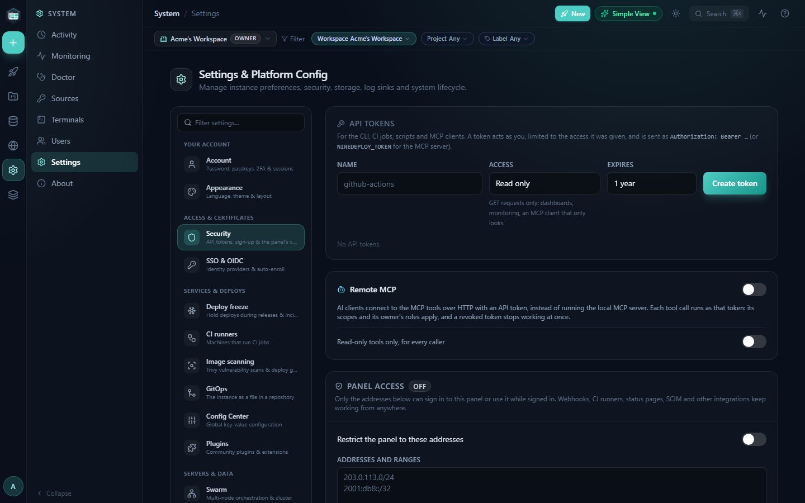
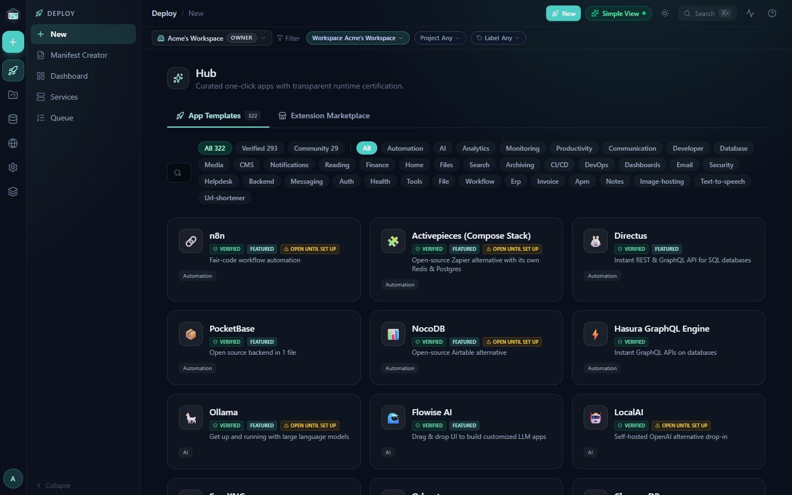
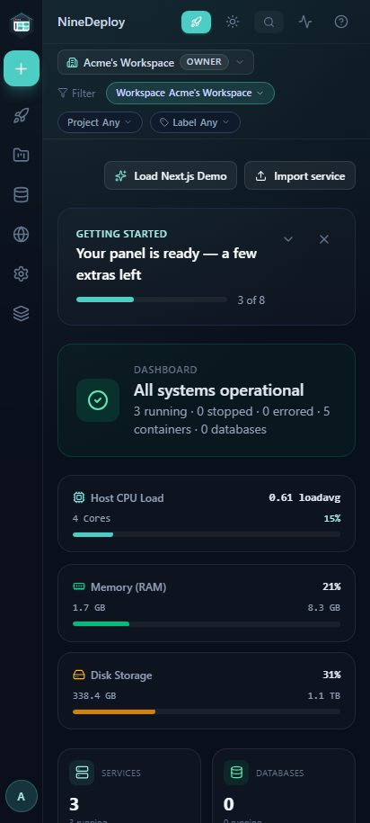

<div align="center">

# NineDeploy

**A self-hosted PaaS for servers you actually own.**

Push a branch, get a healthy container behind TLS. NineDeploy builds from Git or pulls from a
registry, keeps the previous container serving until the new one passes its healthcheck, and manages
the databases, certificates, secrets, backups and access rules around it — from a web panel, a
terminal CLI, a typed SDK, or an AI agent over MCP.

[](./LICENSE)
[](./CHANGELOG.md)
[](https://nodejs.org)
[](https://www.typescriptlang.org)
[](https://docker.com)
[](#testing)
[](https://github.com/NineDeploy/NineDeploy/actions/workflows/ci.yml)

[Website](https://ninedeploy.com) · [Quickstart](./docs/QUICKSTART.md) · [Docs](./docs/README.md) · [Support matrix](./docs/SUPPORT_MATRIX.md) · [Architecture](./ARCHITECTURE.md) · [Templates](https://ninedeploy.com/templates) · [Changelog](./CHANGELOG.md)

</div>




---

## What it is

One Node process, one SQLite file, and the Docker socket on a machine you control. That process
builds your repositories, runs them as containers (or PM2 processes, or Compose stacks), writes
Traefik's routing config, provisions Postgres/MySQL/Redis/Mongo/ClickHouse and friends, encrypts
every secret and every backup it stores, and exposes the whole surface as a REST API that the
dashboard, the CLI, the SDK and the MCP server all speak.

**What it replaces:** a hand-rolled pile of `docker run` invocations, nginx vhosts, certbot cron
jobs, `pg_dump | gzip | aws s3 cp` scripts, and a wiki page nobody has updated since the last
migration.

**What it is not:** a Kubernetes distribution, a multi-region control plane, or a hosted service.
There is no general cluster scheduler, no service mesh and no cluster consensus — just one panel that
drives Docker on one host, and optionally on a handful of remote ones. It places each service on the
server you choose, keeps its replicas and canary steps under its own control, and can hand placement to
Docker Swarm for stateless services.

### A look around

| | |
|---|---|
|  |  |
| **Services**, with live CPU and memory | **A service**: status, telemetry, runtime details |
|  |  |
| **A deploy**: every stage, then the log | **Security**: scoped API tokens, remote MCP, panel IP allow-list |
|  |  |
| **The Hub**: one-click templates, verified and pinned | **On a phone** |

The recording and the screenshots come from the browser journeys in [`e2e/`](./e2e), run against a real panel (`e2e/tests/hero.spec.ts` and `e2e/tests/screens.spec.ts`). The recording is cut where the deployment waits for its container.

## Why NineDeploy

The usual building blocks are all here: Git and image deploys, TLS, databases, backups, previews and teams. These are the parts it does differently. Each one links to the page that proves it.

- **Backups that are proven to restore.** A restore drill loads a backup into an isolated copy, checks the data you named, and records how long the restore took. It never touches the source. This works for all eleven managed engines, from PostgreSQL to RabbitMQ. PostgreSQL also gets point-in-time recovery into a new database. → [Restore verification](./docs/RESTORE_VERIFICATION.md)
- **Protected production lanes.** A lane can hide its variables and logs from members who can still deploy to it. It can also hold every deploy until a lane admin approves it, whether a push, a schedule or a deploy hook started it. → [Protected lanes and approvals](./docs/DEPLOYMENTS.md#protected-lanes-and-deploy-approvals-01613)
- **AI agents with the same permissions as people.** The panel serves MCP over HTTP with OAuth 2.1 or scoped API tokens. Every tool call goes through the same role, scope, 2FA and IP checks as a direct API call. → [MCP, CLI and SDK](./docs/AI_MCP_CLI.md#remote-mcp-over-http-r4)
- **Hard to talk into running something else.** Commands run as argument lists, never as shell strings built from input. A fresh panel accepts its first admin only with the installer's one-time setup token. Releases are signed. The installer checks each release archive against its signed checksums, and checks the signature itself when cosign is installed. The git fallback paths rely on TLS only. → [Security](./docs/SECURITY_SSO.md), [Verifying a release](#verifying-a-release)
- **Your secrets stay on your server.** Secrets and backups are encrypted with a master key on the host. External secret managers are optional: Vault/OpenBao, AWS, GCP, Azure, 1Password, or your own command. There is no telemetry. Apart from Docker pulling the images it runs (Traefik, databases, build helpers), the panel calls out only to services you configure, plus a release check you can turn off with `NINEDEPLOY_UPDATE_CHECK_URL=disabled`. → [Secret managers](./docs/SECRET_MANAGERS.md)
- **It says what it cannot do.** Every service reports which features work where it runs, and why the others do not. The [support matrix](./docs/SUPPORT_MATRIX.md) is generated from the same code.

### How it compares

Coolify, Dokploy and CapRover are the closest alternatives. They are older, have larger communities and longer template catalogs, and Coolify also ships MCP and image scanning. `ninedeploy import` moves services, databases, volumes and domains from them, and from a Heroku app's `app.json` and `Procfile` ([docs/IMPORTING.md](docs/IMPORTING.md); CapRover is checked against a live instance, Coolify and Dokploy against their source code). If you already run one of them happily, the reasons to switch are the points above. Feature names alone are not a reason: our capabilities come with stated limits, and we have not verified every competitor's depth.

---

## Requirements

| | |
| :--- | :--- |
| **Host** | Linux. The installer sets up Node and Docker by itself on: <ul><li>**Debian and Ubuntu**, from signed APT repositories;</li><li>**RHEL, Rocky, Alma, CentOS Stream, Oracle Linux and Fedora**, from signed RPM repositories;</li><li>**Alpine**, from its own `docker` package under OpenRC, **Docker mode only**;</li><li>**openSUSE Leap, Tumbleweed, SLES, Arch, Manjaro and EndeavourOS**, Docker from the distribution's own packages (on SLES, with the Containers Module active). For the bare-metal mode, Node comes from NodeSource's signed RPMs through zypper on openSUSE/SLES, and from Arch's own LTS packages (with `npm`) on Arch and its derivatives.</li></ul>A host without systemd, such as Alpine, is installed in Docker mode; asking for `--bare-metal` there is refused. On Alpine, run `apk add bash curl` first. Other distributions work if Node and Docker are already present. |
| **Runtime** | Node.js 22.23.4+, 24.22.1+ or 26.12.1+ within those supported majors (bare-metal mode only); Docker Engine + the Compose plugin. Docker/CI use Node 26.12.1. |
| **Ports** | `80`/`443` free for Traefik. The panel listens on port `3000` over plain HTTP. **Since 0.16 a fresh install publishes it on `0.0.0.0` in both modes** and prints `http://<server-ip>:3000` plus a one-time **setup token** that the first-admin form requires (pass `--private` to keep it on `127.0.0.1`). Upgrades keep their bind: older Docker installs stay on `127.0.0.1` (`NINEDEPLOY_BIND`), bare metal on `NINEDEPLOY_HOST`. Once a domain with HTTPS is attached in Docker mode, the panel container joins the proxy's network and the domain answers whether or not port `3000` is published, so bind it to `127.0.0.1` (`NINEDEPLOY_BIND`) to keep it off the internet. On bare metal keep the port reachable from Docker and block it with a firewall in front of the host. The panel's **Doctor** page (`GET /v1/doctor`) warns when the panel listens on a non-loopback address over plain HTTP. |
| **Privileges** | `sudo` for the installer in **both** modes. Bare metal uses it for the systemd unit, firewall and optional PM2. Docker mode still uses it for base packages and Docker itself (`apt-get`, `systemctl enable docker`), swap, `ufw` rules for 22/80/443, stopping a stock `apache2`/`nginx` that holds 80/443 on a fresh host, and creating `/opt/ninedeploy-docker`. Membership in the `docker` group is enough only for running and upgrading the stack with `docker compose` afterwards. |

---

## Install

### Bare metal (recommended for production)

```bash
curl -fsSL https://raw.githubusercontent.com/NineDeploy/NineDeploy/main/install.sh | bash
```

Installs Node and Docker if missing, drops a checksum-verified Nixpacks binary in place, downloads
the resolved release's source archive — checked against the release's signed `SHA256SUMS`, see
[Verifying a release](#verifying-a-release) — into `~/ninedeploy` (falling back to a
`git clone` only if the tarball is unreachable; `--channel main` always uses git), generates a 32-byte JWT secret and a master key into a `0600` `.env`,
runs the SQLite migrations, and starts a hardened `systemd` unit (`ProtectSystem=full`,
`NoNewPrivileges`, `PrivateTmp`, `Restart=always`) gated on `/health`.

Re-running the same command is the upgrade path; it snapshots `.data` before touching anything.

```bash
./install.sh --version v0.20.0     # pin an exact tag
./install.sh --domain panel.example.com --email you@example.com   # panel on its own domain, HTTPS from the first boot
./install.sh --channel stable     # newest release that has soaked for 7 days (security fixes at once)
./install.sh --channel main       # track edge
./install.sh --force              # discard local edits + stale build artifacts, then rebuild
```

> **Where `main` stands:** the default channel installs the newest published release tag.
> Work lands on `main` before it is tagged — see [`CHANGELOG.md`](./CHANGELOG.md) under *Unreleased*
> for changes awaiting a release, or run `--channel main` to get it today.

### Docker

Same installer, container mode — no host Node.js, no panel systemd unit, no PM2:

```bash
curl -fsSL https://raw.githubusercontent.com/NineDeploy/NineDeploy/main/install.sh | bash -s -- --docker
```

The installer writes `/opt/ninedeploy-docker/docker-compose.yml` and a `0600` `.env` beside it, and
pins the panel image to the release it installed (`NINEDEPLOY_IMAGE_TAG=vX.Y.Z` in that `.env`;
`edge` on `--channel main`).
Because of that pin, a bare `docker compose pull && docker compose up -d` does **not** move you to a
newer release. To upgrade, re-run the same command (or `./install.sh --docker`); to move by hand,
edit `NINEDEPLOY_IMAGE_TAG` in `.env`, then `docker compose pull && docker compose up -d`.

Or bring your own compose file (it refuses to boot without a strong `NINEDEPLOY_JWT_SECRET`):

```bash
echo "NINEDEPLOY_JWT_SECRET=$(openssl rand -hex 32)" >> .env
echo "DOCKER_GID=$(getent group docker | cut -d: -f3)" >> .env
docker compose -f docker-compose.prod.yml up -d
```

Or run the image directly:

```bash
docker run -d --name ninedeploy \
  -v /var/run/docker.sock:/var/run/docker.sock \
  --group-add "$(getent group docker | cut -d: -f3)" \
  -v ninedeploy-data:/data \
  -p 127.0.0.1:3000:3000 \
  -e NINEDEPLOY_DATA_DIR=/data \
  -e NINEDEPLOY_DB_PATH=/data/ninedeploy.db \
  -e NINEDEPLOY_JWT_SECRET="$(openssl rand -hex 32)" \
  -e NINEDEPLOY_PUBLIC_URL=https://panel.example.com \
  ghcr.io/ninedeploy/ninedeploy:latest
```

> **Docker mode trade-off:** PM2 services (host processes) and UFW firewall management need the
> bare-metal installer. Docker/Compose deploys, managed databases, Traefik ingress and encrypted S3
> backups behave identically — the panel drives them as sibling containers through the mounted socket.

### From source (development)

```bash
git clone https://github.com/NineDeploy/NineDeploy.git && cd NineDeploy
corepack enable && pnpm install && pnpm build
pnpm dev        # API + built dashboard on :3000
pnpm dev:web    # Vite dashboard on :5173 against that API
```

### First boot

1. Open the URL the installer printed (`http://<server-ip>:3000/login#setup-token=…` pre-fills the
   token). **The first account created becomes the instance operator**, so since 0.16 creating it
   needs the installer's setup token (`NINEDEPLOY_SETUP_TOKEN` in `.env`; a bare `docker run` logs a
   generated one at boot and keeps it in `/data/setup-token`). The CLI takes it too:
   `ninedeploy setup --setup-token <token>`. It owns a personal workspace; every later signup is an
   ordinary member until someone grants more.
2. Point a wildcard DNS record (`*.apps.example.com`) at the host. If the installer did not get an email
   (`--email`), and you did not use the admin email for it on the first-run form, set the ACME email
   under **Settings → Security**. Traefik issues certificates from then on, including DNS-01 wildcards.
   `install.sh --domain panel.example.com --email you@example.com` puts the panel itself on HTTPS from
   the first boot.
3. `ninedeploy doctor` from your laptop, or the **About** page in the panel, reports what is missing.

Full matrix — environment variables, upgrade paths, systemd internals — in
[**docs/QUICKSTART.md**](./docs/QUICKSTART.md).

### Verifying a release

Since **0.10.43** every release is signed without a maintainer-held key: the release workflow signs
with a short-lived [Sigstore](https://www.sigstore.dev/) certificate issued to
`release-publish.yml` itself through GitHub's OIDC token (cosign *keyless*), and each signature is
recorded in Sigstore's public transparency log. The same identity is used everywhere:

```bash
ID='^https://github\.com/(?i:ninedeploy/ninedeploy)/\.github/workflows/release-publish\.yml@refs/(tags/v[0-9]+\.[0-9]+\.[0-9]+|heads/main)$'
```

**The image** — the multi-arch digest behind `ghcr.io/ninedeploy/ninedeploy:vX.Y.Z` is signed and
carries SLSA build provenance (`:latest` is a retag of that same digest):

```bash
cosign verify ghcr.io/ninedeploy/ninedeploy:v0.10.43 \
  --certificate-identity-regexp '^https://github\.com/(?i:ninedeploy/ninedeploy)/\.github/workflows/release-publish\.yml@refs/(tags/v[0-9]+\.[0-9]+\.[0-9]+|heads/main)$' \
  --certificate-oidc-issuer https://token.actions.githubusercontent.com
gh attestation verify oci://ghcr.io/ninedeploy/ninedeploy:v0.10.43 --repo NineDeploy/NineDeploy
```

To run exactly what you verified, pin the digest `cosign verify` prints (`…/ninedeploy@sha256:…`).

Signatures are stored in the Sigstore bundle format, which **cosign v3** reads by default. With
cosign v2, add `--new-bundle-format` to both `cosign verify` (v2.6+) and `cosign verify-blob`
(v2.4+); cosign v2.5 and older report `no signatures found` for the image even though it is signed.

**The source and the desktop installers** — each GitHub Release carries `ninedeploy-vX.Y.Z.tar.gz`
(a `git archive` of the tag), `install.sh`, the [desktop installers](docs/DESKTOP.md) (from
0.18.25), `SHA256SUMS` over all of them, and `SHA256SUMS.sigstore.json` (its signature):

```bash
cosign verify-blob --bundle SHA256SUMS.sigstore.json \
  --certificate-identity-regexp "$ID" \
  --certificate-oidc-issuer https://token.actions.githubusercontent.com SHA256SUMS
sha256sum -c --ignore-missing SHA256SUMS
```

`install.sh` does this itself for releases that publish checksums: it installs the release archive
only when its sha256 matches `SHA256SUMS` — a mismatch stops the installer before anything is
replaced — and when `cosign` (v2.4+) is on the host it verifies the signature first, failing the same
way (`NINEDEPLOY_SKIP_SIGNATURE_VERIFY=1` falls back to the checksum alone, e.g. on a host that cannot
reach Sigstore). Without cosign it says so in one line and relies on the checksum. The panel's
one-click update runs the target release's `install.sh` only when it matches that release's
`SHA256SUMS` the same way. Releases before 0.10.43 publish none of this; installing one (`--version`)
still uses GitHub's tag archive, verified by TLS only, with a warning.

What it proves, and what it does not: the signer is this repository's release workflow, run for a
`vX.Y.Z` tag or dispatched from `main`. The trust root is GitHub (the repository, Actions, its OIDC
tokens) plus Sigstore (Fulcio, Rekor) — not a key a maintainer holds. Whoever can push a tag or edit
that workflow can produce a validly signed release; what the signature rules out is substitution
afterwards — an archive, installer or image modified anywhere between the workflow and your host. The
`git` fallback paths (`--channel main`, a clone-based install, an unreachable asset host) are verified
by TLS to github.com only.

---

## How the pieces fit

```
   browser · ninedeploy CLI · SDK · MCP agent          git push / PR event
                    │                                          │
                    │ HTTPS                                    │ HMAC-signed webhook
                    ▼                                          ▼
        ┌───────────────────────────┐              ┌────────────────────────┐
        │  Traefik v3               │              │  POST /v1/hooks/:id    │
        │  :80 / :443 · ACME certs  │              │  branch + path match   │
        │  per-domain middlewares   │              └───────────┬────────────┘
        └─────────────┬─────────────┘                          │
                      │ routes by hostname                     │
                      ▼                                        ▼
      ╔═════════════════════════════════════════════════════════════════════╗
      ║  NineDeploy panel — Fastify 5 API + React 19 dashboard, one process ║
      ║ ─────────────────────────────────────────────────────────────────── ║
      ║  118 route modules                deploy engine (queue + worker)    ║
      ║  microkernel: events · hooks      shapes:  docker·pm2·compose·swarm ║
      ║  SQLite (99 tables, Drizzle)      AES-256-GCM vault + key ring      ║
      ╚═══╤═══════════════╤═══════════════════╤══════════════════╤══════════╝
          │ docker.sock   │ docker.sock       │ sealed transport │ S3 API
          ▼               ▼                   ▼                  ▼
    app workloads    managed data        remote agents      off-site backups
    containers       Postgres · MySQL    (sealed typed ops  R2 · AWS · MinIO ·
    PM2 processes    MariaDB · Redis     builds + deploys   Wasabi — dumps,
   Compose stacks   Valkey · Mongo      Traefik on nodes   volumes and PITR
   322 templates     ClickHouse ·        on each node)      archives
                     Meilisearch ·
                     RabbitMQ

    Cloudflare Tunnel ┄┄┄▶ reaches workloads on hosts with no inbound ports
```

Each Docker service gets its own private `nd-svc-<slug>` bridge, with Traefik attached and its
databases joined to it; the shared `ninedeploy` network carries platform plumbing and standalone
databases. Host ports are **not** published unless an operator explicitly asks for one, and reserved
ports (the panel, 80, 443, 22) are refused outright.

---

## What a deploy actually does

Triggered by the panel, a webhook, the CLI, a cron job or a template install:

1. A deployment row is queued; a worker slot claims it atomically and snapshots the build config plus
   an env-key fingerprint — **never** the values — so the UI can diff deploy against deploy.
2. `building` rows older than 45 minutes are requeued on boot, so a panel restart mid-build recovers
   instead of leaving a ghost.
3. **Prepare** — image deploys pull (a rollback pins the exact digest). Repo deploys resolve source
   credentials, check out the commit with the token or SSH key scrubbed from every log line, run a
   best-effort framework analysis, and load `.ninedeploy` from the tree.
4. **Environment** — project-shared vars ← service vars ← attached-database connection strings, then
   `${{infisical:KEY}}` / `${{doppler:KEY}}` references resolved at deploy time and never stored. A
   deploy fails if an attached database is not running.
5. **Build** — the manifest fills in whatever the panel left empty (`panel > manifest > auto-detect`),
   `runtime`/`phases` render into a real `nixpacks.toml`, then the builder runs: Dockerfile via
   buildx, Nixpacks or Railpack for Dockerfile-less repos, Paketo or Heroku buildpacks, a static
   site, install-and-build under PM2 on the host, `docker compose up -d --build`, or a Swarm
   service. A deploy into a lane that requires approval, or one gated on required CI checks,
   waits first.
6. **Boot** — the new runtime starts with secrets injected through a `0600` temp env-file that is
   deleted immediately after start, plus networks, volume attachments, CPU/memory limits and the
   restart policy. **The old container keeps serving.**
7. **Healthcheck** — container liveness *and* an HTTP probe against the new container's network IP,
   retried with a fresh abort signal per attempt for up to five minutes.
8. **Cut over** — only after the probe passes: finalize the row, persist the image digest, demote
   older `running` deploys to `superseded`, assign the wildcard domain, flip Traefik, wait two
   seconds, then retire the previous container.
9. **On failure** — the new runtime is torn down and the old one keeps serving; only the deployment is
   marked failed. (PM2 is stop-then-start, so it has no blue-green window.)
10. **Cancel** — the pipeline re-reads its own status at every checkpoint and tears down partial work.

Logs stream over WebSocket while this happens, are stage-tagged (`##[stage:BUILD:running]`) for the
stepper UI, and persist to disk. Every subprocess has a hard timeout and is tree-killed.

Watch paths, `[skip ci]` handling, cancellation and PR previews: [**docs/DEPLOYMENTS.md**](./docs/DEPLOYMENTS.md).

---

## Features

### Deployments

- **Blue-green with automatic rollback** for Docker services. Manual rollback redeploys a recorded
  commit or image using current settings and environment.
- **Recorded inline Compose restores (0.17.1):** encrypted resolved configuration/environment
  and pinned local images, with [explicit recovery limits](docs/DEPLOYMENTS.md#recorded-compose-releases-0171).
- **Four runtime shapes:** containers, PM2 host processes, Compose stacks (`ndcmp-` prefixed) and,
  for stateless services, Docker Swarm (opt-in). PM2 and Compose are host-privileged and therefore
  operator-only.
- **Ephemeral PR previews** — a pull request spins up `service-pr-123` with the parent's non-secret
  config plus its optional preview-only variables (production secrets are withheld, and the webhook
  response reports how many), capped by a max-active limit and destroyed when the PR closes. A
  preview can get its own database copy (PostgreSQL and the Redis family), and a fork's PR builds
  only after approval.
- **Watch paths, branch filters and `[skip ci]`**, so a docs commit does not rebuild the API.
- **Canaries, autoscaling and scale to zero** — shift traffic to a new release in weighted steps,
  run between a minimum and a maximum number of replicas on CPU, memory or requests per second,
  and stop an idle service until its next request wakes it.
- **Gates on every deploy path** — protected lanes with approval, required CI checks before a
  deploy, deploy freezes, and opt-in image auto-update when a pushed tag's digest moves.
- **Scheduled jobs** — 5-field cron attached to any service, with preset editors, human-readable
  schedule descriptions and per-job run history.
- **Per-deploy config diff** — what changed in the build config and which env keys moved, without
  ever storing a value.

### Ingress and TLS

- Traefik v3 as the single public listener; dynamic config written atomically into a directory bind
  mount, with Host/Path operands sanitized against rule and YAML injection.
- Let's Encrypt HTTP-01 and DNS-01 (wildcards) through Cloudflare, DNSimple, Namecheap, Route 53,
  OVH, Porkbun or Hetzner DNS, with certificate expiry parsed out of `acme.json` and fed into the
  alert evaluator.
- Per-domain middlewares: www→apex redirect, custom response headers, basic auth, IP allowlists, rate
  limits.
- **Custom dynamic config** (0.14): your own `custom-*` routers, middlewares and services next to the
  generated ones, validated and loaded by a throwaway Traefik before the live one sees them.
- **Uploaded certificates** (0.14): bring a commercial, internal-CA or wildcard certificate; a domain it
  fully covers stops using the ACME resolver, and it feeds the expiry alert like ACME ones.
- **Traffic analytics** (0.15, opt-in): requests, status classes and latency percentiles per domain and
  service, from a JSON access log that keeps no client address, path or header. Off, Traefik's config
  is byte-identical to 0.14; Traefik's own container log is rotated on the json-file/local drivers.
- **Cloudflare Tunnels** for hosts with no inbound ports.
- **Panel sign-in in front of any app** (forward auth), **maintenance mode** and **custom error
  pages**: each change succeeds only after the proxy confirms it, and a failed apply restores the
  previous setting.
- Non-operators must **prove control of a hostname** before attaching it.

### Data services

- One-click **Postgres** (with `pgvector`), **MySQL**, **MariaDB**, **Redis**, **Valkey**, **KeyDB**,
  **Dragonfly**, **MongoDB**, **ClickHouse**, **Meilisearch** and **RabbitMQ**.
- Attach a database to a service and its connection string is injected as environment on every
  deploy — resolved fresh from the vault rather than pasted into a `.env` once and forgotten.
- Database Studio, served through the panel's own origin and limited to instance operators; a topology view; per-database resource limits.
- **Public database access** (0.14, operator-only): a per-database Traefik TCP sidecar on its own
  host port, with a required IP allow-list and optional TLS termination.
- **Dump import** (0.14): chunked, resumable upload or an S3 object, with format detection and a
  `pre-import` safety backup first.
- **Major version upgrades** for PostgreSQL, MySQL and MariaDB on the panel host: each moves the
  data through a verified copy rather than a cross-version dump, compares it before the switch, and
  can be rolled back until you finalize.
- **PostgreSQL point-in-time recovery** into a new database, with an optional off-site archive:
  encrypted checkpoints or continuous WAL shipping to an S3-compatible store, and an offline
  recovery tool that needs neither the lost panel nor its master key.
- **PgBouncer** connection pooling per database, and **`ninedeploy tunnel`** to reach a database or a
  service port through the panel on a local port.

### Backups

- Streaming **AES-256-GCM** encryption on write for database dumps *and* volume archives; restore and
  download decrypt transparently, and legacy plaintext dumps still restore.
- Off-site sync to **Cloudflare R2, AWS S3, MinIO or Wasabi**, with retention pruning.
- Snapshots carry labels (`manual`, `schedule-…`, operator tags) that surface on the Backups page
  alongside scope and volume names.
- **Per-database backup policies**: a cron schedule, a retention count and a destination, with up
  to three replica destinations.
- **Restore verification**: a drill loads a backup into an isolated copy, checks the data you name
  and records how long the restore took, for all eleven managed engines.
- Restores are tar-slip validated before extraction and ownership-checked before they run.

### Access control

- **Workspaces** carry membership and four roles (`owner` / `admin` / `member` / `viewer`), enforced
  at the route layer: reads need any seat, writes need `member`, deletion and re-tagging need `admin`.
- **Instance operator** is a separate, explicitly granted flag — not something you can hand yourself
  by creating a workspace — and it gates the host-privilege boundary: PM2, Compose, deploy lifecycle
  hooks, Docker-socket templates and published ports.
- **API tokens carry scopes** (`read` / `write` / `operator`) applied centrally in the auth plugin, so
  a CI or MCP token can never outrank its owner. Tokens support expiry, and remote MCP clients
  receive fine-grained URI scopes.
- **Protected lanes** (environments): a lane can hide its variables and logs from members who can
  still deploy to it, and hold every deploy until a lane admin approves it.
- Services can be tagged into many **workspaces, projects and labels** at once, and the whole panel
  filters by all three — AND across the groups, OR inside one.
- **Project and environment access grants** (0.15): raise one user's role on a project, an environment
  or both, on top of their seat — or give a seatless guest access to just that. Grants never lower a
  role, can be suspended (and are held by SCIM), and a rollback to 0.14 only ever removes access.

### Secrets and hardening

- AES-256-GCM in versioned envelopes with a rotatable master-key ring and a re-encryption job; older
  envelopes stay readable.
- **SSRF egress guard** on the operator-supplied outbound URLs whose targets are normally public:
  notification channels, log drains, push delivery, git remotes, OAuth token exchange, the
  marketplace catalog and `templates_source`. Private, loopback and link-local targets are refused,
  closing the `169.254.169.254` metadata path. It is deliberately **not** applied to the OIDC issuer,
  the S3 endpoint, the log-search backend or the telemetry endpoint — self-hosted Keycloak,
  MinIO and Loki normally *are* on a private address, so guarding those would break working installs.
  Those settings are operator-only, and an operator can already run host commands through a service.
  The 0.14 secret managers are guarded; a Vault on a private address needs
  `NINEDEPLOY_ALLOW_PRIVATE_EGRESS=1`.
- **Secret managers:** `${{infisical:…}}` / `${{doppler:…}}`, and from 0.14 HashiCorp Vault / OpenBao
  (`${{vault:path#field}}`) and AWS Secrets Manager (`${{aws:id#key}}`); GCP Secret Manager, Azure
  Key Vault, 1Password Connect and an operator-supplied command followed. References are resolved at
  deploy time, never stored, and withheld from PR previews.
- **Git host key pinning** (0.15.8, opt-in per deploy-key source): the first successful clone learns the
  host's SSH keys and later clones refuse a host that presents a different one. Off, and resetting,
  need a password re-check. Off by default, so existing sources behave as before.
- Subprocesses inherit a whitelisted environment (never `NINEDEPLOY_*`), and the panel refuses to boot
  in production with a known-insecure JWT secret or a weak master key.
- **SSO and 2FA:** OpenID Connect (Google, GitHub, Keycloak, Okta) and SAML providers with account
  linking, SCIM 2.0 provisioning, a per-workspace rule that requires a second factor, WebAuthn
  passkeys, TOTP with replay protection, login lockout, per-session revocation, and an optional IP
  allow-list for the panel itself.

### Fleet

- Remote hosts run the same binary with `NINEDEPLOY_AGENT=1` and register with a one-time token. The
  panel drives them through **typed operations** from a fixed registry (more than a hundred) rather
  than a command line, with every operand regex-validated on both ends. The transport is sealed
  and authenticated by default.
- **Deploy to a node, not through the panel.** A `docker` service pinned to a `server_id` is built
  and started on that host through the typed agent protocol: the repo is checked out in a
  per-service workspace on the node, the image is built or pulled there, and the environment
  arrives as a 0600 env-file that is deleted the moment the container has taken it.
- **Each node runs its own Traefik.** The node terminates TLS for the services that live on it, so
  you point the domain at the *node* and production traffic never hairpins through the panel. The
  panel stays the source of truth for domains, middlewares and certificate policy: it renders both
  Traefik configs and ships them to the node, which only writes them to a fixed path. A routing
  change refreshes every node automatically; the proxy is only recreated when the *static* config
  changed, so a domain edit is not an ingress interruption.
- **Compose stacks run on a node too**, which matters because most of the one-click template
  catalogue is compose-shaped: the panel ships an inline stack's YAML (or the node checks the repo
  out), writes the `.env` and any volume-attachment override, and then runs the same
  preflight-then-up ordering the local builder uses — `compose config` and `compose pull` complete
  while the previous revision is still serving, so a broken `${VAR}` or a bad tag fails the deploy
  without ever tearing the live stack down. The platform restart policy is applied afterwards,
  because a compose file with no `restart:` leaves every container dead after a reboot.
- **Nodes match the panel host** (0.15.2–0.15.4, each feature behind a capability the node's agent
  advertises): Nixpacks and Railpack builds, private clones with a PAT or deploy key (opt-in per
  source), volume attachments with backups over an encrypted stream, managed databases with backups
  and restores, builds on the panel or a dedicated build server with the image shipped and verified,
  and Docker Swarm, opt-in on the panel and on each node. Since then nodes also serve maintenance
  and error pages, run the restart-loop limit and pre- and post-deploy hooks, host database
  clients, Studio, PgBouncer and public database access, run GitHub Actions runners when their
  owner opts in, and take part in Swarm as workers. A node whose agent is too old answers
  `422 node_agent_outdated` naming the version to install, and nothing else changes. See
  [MULTI_NODE.md](./docs/MULTI_NODE.md).
- PM2 services on a node are **refused at queue time** with a reason — the node agent has no
  operation for them, and a container on the wrong host is worse than a deployment you can read.
  See *Known limits*.

### Observability

- Live deploy logs over WebSocket, plus a container file browser and a volume browser.
- **Terminals** (0.15, operator-only): container, database and node shells with a real TTY and resize,
  single-use tickets and idle/length limits; host shells off by default behind a password re-check
  and kill switches; node shells over an encrypted agent channel (agent v0.15.0). Every session is
  audited as metadata, never as a transcript.
- 30-second metric samples feeding threshold **alert rules** (CPU, memory, error rate and p95 latency
  per service; certificate expiry, disk usage across the panel host and nodes, and remote servers
  gone offline host-wide) with a breaching → firing → recovered state machine and a 30-minute
  anti-spam cooldown.
- **Log drains** to syslog, Loki, Vector, Datadog, HTTP, Elasticsearch, Splunk, Better Stack, New
  Relic, Axiom or CloudWatch, over a durable queue.
- **Uptime monitors and status pages**: HTTP and TCP checks from the panel with down and up
  alerts, and public status pages with a 90-day history.
- **Resource history and export**: 1 to 90 days of per-container history, with opt-in Prometheus
  and OTLP export.
- **Error ingest**: a Sentry-compatible endpoint per service, grouped by fingerprint and tied to the
  deploy that introduced an issue.
- **Image scanning**: Trivy scans on a schedule and, optionally, as a deploy gate.
- **Notifications** through 17 channel types (Telegram, Discord, Slack, Microsoft Teams, Mattermost,
  PagerDuty, Opsgenie, email, webhooks and more) with a per-channel event filter.
- An audit trail with a global event stream, and per-repository framework insights.

### Extensibility

- A **microkernel** with an event bus, waterfall hook pipeline, service registry, config center and
  dynamic menu registry; plugins are written against `@ninedeploy/plugin-sdk`.
- **322 one-click templates** (n8n, Directus, PocketBase, Ollama, Hasura, …) across 37 categories. 293 are marked runtime-verified in the Hub: each was started in an isolated container and answered on its port. They include 175 stacks converted from the Coolify catalog and 20 from Dokploy's blueprints.
- **One-click panel self-update:** a dashboard banner runs *this install's own* `install.sh` for the
  pinned tag, detached through `systemd-run` so it survives stopping its own unit, and reports the
  installer output tail when it fails.

---

## The `.ninedeploy` manifest

Keep the deployment shape next to the code. The pipeline folds the `build`, `run` and `resources` sections into the deploy under a
`panel > manifest > auto-detect` precedence and announces every value it contributed in the deploy
log.

```yaml
version: "1"

runtime:
  type: node
  version: "22"

build:
  install: pnpm install --frozen-lockfile
  build: pnpm build
  start: node dist/server.js

run:
  port: 3000
  healthcheck: /healthz
  restart: on-failure:3

env:
  required: [DATABASE_URL, STRIPE_KEY]

watch:
  paths: [apps/api/**, packages/shared/**]

routes:
  - host: api.example.com
    path: /
    ssl: true

previews:
  enabled: true
  pattern: pr-{n}-{{slug}}.{{domain}}

alerts:
  - when: highMemory
    thresholdPct: 85
    channel: ops-slack
```

Sixteen configurable sections beyond `version` — `runtime`, `build`, `run`, `static`, `env`, `phases`,
`resources`, `hooks`, `watch`, `routes`, `previews`, `volume`, `database`, `network`, `notifications`
and `alerts` — each with an editor in the panel's Manifest Creator, which also secret-scans what you
are about to commit.

```bash
ninedeploy manifest init       # scaffold one from the repo
ninedeploy manifest validate   # schema-check + block credential-shaped values before they reach git
ninedeploy manifest show
ninedeploy manifest apply <service-id>   # write the build, run and publishPort fields to a service
```

`hooks` is deliberately never honoured from the repo: lifecycle hooks execute on the host, so
accepting them from a commit would hand host execution to anyone with push access. A manifest
declaring `hooks` gets a warning in the deploy log instead of an execution. Two more sections —
`static` and `network` — are accepted and reported as not applied. The `build`, `run` and `resources` sections follow
the precedence rule above; the operational sections (`routes`, `alerts`, `database`, `previews`,
`notifications`, `volume.backups`, `watch`) are written as the repo declares them on each deploy,
and two fields (`env.aliases`, `volume.mount`) are read by nothing.

Full reference: [**docs/NINEDEPLOY_MANIFEST.md**](./docs/NINEDEPLOY_MANIFEST.md).

---

## Clients

### CLI

```bash
npm install -g ninedeploy

ninedeploy init                    # set up and auto-start a local Docker server
ninedeploy login                   # or authenticate against an existing panel
ninedeploy doctor                  # environment and connectivity diagnostics

ninedeploy services list
ninedeploy services create         # interactive wizard
ninedeploy services deploy 12
ninedeploy deploys watch 12 480    # stream a running deployment's logs
ninedeploy deploys cancel 12 480   # stop a queued or in-flight deployment
ninedeploy deploys rm 12 479       # drop a finished deployment from history
ninedeploy env set 12 NODE_ENV production
ninedeploy domains add 12 api.example.com
ninedeploy backups create 3
ninedeploy system dashboard        # live health board
```

66 top-level commands and 248 subcommands, across services, deploys, canaries, autoscaling,
sleep, previews, lanes, approvals, CI, sources and GitHub Apps, databases, backups, PITR, platform
imports, volumes, networks, domains, the proxy and certificates, terminals, tunnels, uptime, servers,
Swarm, secrets, SSO, access grants, workspaces, notifications, log drains, plugins, templates and
system tooling. The token is stored `0600` in `~/.ninedeploy/config.json`. The full reference is in
[docs/AI_MCP_CLI.md](docs/AI_MCP_CLI.md).

### SDK

```ts
import { createClient } from '@ninedeploy/sdk';

const nd = createClient({ baseUrl: 'https://panel.example.com', getToken: () => process.env.ND_TOKEN! });

const services = await nd.services.list();
await nd.deploys.trigger(services[0].id);
```

Typed namespaces over an injectable `fetch`, built from the same Zod schemas the server validates
with.

### MCP (AI assistants)

```json
{
  "mcpServers": {
    "ninedeploy": {
      "command": "npx",
      "args": ["-y", "@ninedeploy/mcp"],
      "env": {
        "NINEDEPLOY_URL": "https://panel.example.com",
        "NINEDEPLOY_TOKEN": "nd_tok_xxxxxxxxxxxx",
        "NINEDEPLOY_MCP_READONLY": "1"
      }
    }
  }
}
```

**64 tools** over stdio or HTTP: 42 hand-written ones, each mapping 1:1 onto the typed SDK so the MCP wire can
never express anything the HTTP API could not, and 22 read-only ones generated from the OpenAPI document: inspection (`list_services`, `service_logs`, `list_deploys`,
`inspect_container`, `topology`, `system_stats`, `activity_log`, …), guarded actions
(`deploy_service`, `restart_service`, `rollback_deploy`, `update_service`, `system_autoprune`), and
configuration writes (`set_config`, `install_plugin`, `enable_plugin`, …).

The panel also serves MCP over Streamable HTTP at `/v1/mcp`, with OAuth 2.1 authorization and an
operator policy; every call passes the same role, scope, 2FA and IP checks as a direct API call.

From 0.15 the panel serves an **OpenAPI 3.1 document** for every route at `GET /v1/openapi.json`
(behind login, with an ETag). The MCP server adds read-only tools generated from it (traffic, grants,
terminal history, backups, servers and more) and `search_api`, which searches the document without
calling anything. There is no generated write tool and no "call any endpoint" tool.

The default surface **mutates**. `NINEDEPLOY_MCP_READONLY=1` exposes only the non-mutating,
non-secret allowlist — and pair it with a `read`-scoped token so the restriction is enforced by the
server rather than by the client.

---

## Repository layout

```
NineDeploy/                    pnpm 11 workspace + Turborepo
├── apps/
│   ├── server/                Fastify 5 API, deploy engine, microkernel, agent mode
│   │   ├── src/engine/        pipeline · builders (docker/pm2/compose/remote/swarm) · database ·
│   │   │                      proxy · tunnel · logs · autoPrune · repoInsights
│   │   ├── src/modules/       118 route modules + one aggregator
│   │   ├── src/lib/           crypto · jwt · sessions · totp · webauthn · oidc ·
│   │   │                      resourceAccess (the authz choke point) · hostPrivilege ·
│   │   │                      egressGuard · s3 · cloudflare · manifest apply
│   │   ├── src/agentOps/      the typed operations a remote node executes
│   │   ├── src/kernel/        event bus · hook pipeline · registries · built-in plugins
│   │   └── src/templates/     322-entry template registry
│   ├── web/                   React 19 + Vite 8 + Tailwind v4 dashboard
│   └── cli/                   `ninedeploy` (commander 15)
├── packages/
│   ├── db/                    Drizzle schema (99 tables) + 129 SQL migrations
│   ├── schemas/               Zod v4 DTOs shared by server, web, CLI, SDK and MCP
│   ├── sdk/                   typed API client over an injectable fetch
│   ├── mcp/                   Model Context Protocol server (64 tools, stdio and HTTP)
│   └── plugin-sdk/            definePlugin + scoped config helpers
├── desktop/                   Electron desktop client (own lockfile)
├── e2e/                       Playwright browser journeys (own lockfile)
├── examples/                  Ten framework starters, from Next.js to a static site
├── docs/                      53 documents: operator guides, dated records and plans
├── install.sh                 one-command installer and upgrader
├── Dockerfile                 multi-stage, non-root, checksum-pinned build tools
└── ARCHITECTURE.md            the full internal design spec
```

---

## Testing

```bash
pnpm test           # every package
pnpm release:check  # runtime check → typecheck → lint → build → contracts → test
pnpm build && RUN_INTEGRATION=1 pnpm --filter @ninedeploy/server exec vitest run --config vitest.integration.config.ts
                    # testcontainers: real PostgreSQL/MySQL/Redis/MongoDB, deploy, Compose, registry suites
```

| Package | Test files | Coverage floor (stmts / branch / func / lines) |
| :--- | ---: | :--- |
| `apps/server` | 888 | 93.25 / 87.3 / 91 / 95.1 |
| `apps/web` | 247 | 97.5 / 91.5 / 97.5 / 97.5 |
| `apps/cli` | 69 | 83 / 80 / 80 / 83 |
| `packages/db` | 36 | 100 |
| `packages/schemas` | 44 | 100 |
| `packages/sdk` | 40 | 100 |
| `packages/mcp` | 4 | 90 / 80 / 95 / 95 |
| `packages/plugin-sdk` | 1 | 100 |
| `desktop` | 5 | no gate |
| **Total** | **1,334** | |

These are the unit, route and regression suites. The server's fourteen integration files (real
PostgreSQL, MySQL, Redis and MongoDB backup and restore, a deploy end-to-end, a Compose stack, a volume
snapshot and restore, container probe HTTP, the backup-drill helper, image reference validation and
registry credential handling) live in `apps/server/test/integration`, which
the default config excludes. They run only through `vitest.integration.config.ts` with
`RUN_INTEGRATION=1`, as their own CI job.

The server, web, CLI and MCP floors sit below 100, with the reasoning recorded inline in each
`vitest.config.ts` — an enforced gate beats an aspirational one that gets bypassed. CI runs
typecheck → lint → build → contract preflight → test, a schema-drift check, a
deprecated-dependency check, an installer check, a Docker image build with real-routing smokes, and
the integration job. The last recorded full gate (the 0.19.0 candidate, November 18, 2026) passed
20,155 tests with zero failures; see [Current status](docs/CURRENT_STATUS.md).

The production dependency audit retains the upstream `braces@3.0.3` advisory
([GHSA-vfj7-8cjw-p6xm](https://github.com/advisories/GHSA-vfj7-8cjw-p6xm)). There is
no fixed upstream release. NineDeploy applies a lockfile-pinned local patch
that limits parse/AST nesting to 256 levels; the actual copy PM2 resolves is
checked by `dependencyDepth.test.ts`. This advisory is documented, not ignored
or reported as a clean audit. Remove the patch when an upstream fix is adopted.

---

## Documentation

| Guide | What is in it |
| :--- | :--- |
| [Quickstart & upgrading](./docs/QUICKSTART.md) | Install modes, environment variables, systemd internals, in-place upgrades |
| [Framework starters](./docs/FRAMEWORK_STARTERS.md) | Deploying the bundled examples from a local folder: Next.js, Laravel, FastAPI, Django, Rails, Express, Astro, Go, Spring Boot and a static site |
| [Support matrix](./docs/SUPPORT_MATRIX.md) | Which service features work on the panel host, on nodes, on Swarm, and for Compose and PM2; generated from the code |
| [Current status](./docs/CURRENT_STATUS.md) | What is implemented, accepted and published |
| [Deployments & pipelines](./docs/DEPLOYMENTS.md) | Builds, health checks, zero-downtime releases, canaries, autoscaling, scale to zero, previews, protected lanes and approvals |
| [Rolling back](./docs/ROLLBACK.md) | What a rollback to the previous release leaves behind, and how to clean it up |
| [Private repositories](./docs/PRIVATE_REPO_GUIDE.md) | GitHub PATs, server-generated SSH deploy keys and git host key pinning, build-pack choice, auto-deploy webhooks, commit statuses |
| [GitHub App](./docs/GITHUB_APP.md) | One-click App setup, installation tokens, per-service links, required CI, runners |
| [CI on your own runners](./docs/CI_RUNNERS.md) | Running CI jobs on the panel host or on your own servers |
| [Moving from another platform](./docs/IMPORTING.md) | Read-only plans, then moving services, databases, volumes and domains from Coolify, Dokploy, CapRover or Heroku |
| [The `.ninedeploy` manifest](./docs/NINEDEPLOY_MANIFEST.md) | Every section, precedence rules, and the `manifest init/validate/show/apply` CLI |
| [Databases & backups](./docs/DATABASES_BACKUPS.md) | Engines, connection strings, encryption, backup policies, S3 destinations, restores, dump import, major upgrades |
| [Remote PITR archives](./docs/PITR_REMOTE_CHECKPOINTS.md) | Encrypted PostgreSQL checkpoints or continuous WAL to S3, and clean-host recovery |
| [Restore verification](./docs/RESTORE_VERIFICATION.md) | Restore drills and point-in-time recovery |
| [Panel backup](./docs/PANEL_BACKUP.md) | Backing up and restoring the panel's own database and keys |
| [Disaster recovery](./docs/DISASTER_RECOVERY.md) | Recovering the panel, application volumes and databases after losing a host |
| [Ingress, routing and tunnels](./docs/TRAEFIK_INGRESS.md) | Dynamic routing, ACME HTTP-01 and DNS-01, middlewares, panel sign-in, maintenance pages, Cloudflare Tunnels, custom config, certificates, traffic analytics |
| [Remote nodes](./docs/MULTI_NODE.md) | Enrolment, agent updates, the capability table, builds on nodes, build placement and image transfer, node volumes and databases, Swarm |
| [Node operations](./docs/NODE_OPERATIONS.md) | Readiness, metrics, logs and files on nodes |
| [Node sleep and wake](./docs/NODE_SLEEP_WAKE.md) and [request-rate autoscaling](./docs/NODE_RPS_AUTOSCALING.md) | Scale to zero on nodes and what wakes a sleeping service |
| [Workspaces & roles](./docs/WORKSPACES_RBAC.md) | Tenancy, invitations, the role matrix, the instance-operator flag, access grants |
| [Security & SSO](./docs/SECURITY_SSO.md) | The vault, 2FA, passkeys, OIDC, SAML, SCIM, session handling, the panel allow-list |
| [Secret managers](./docs/SECRET_MANAGERS.md) | Infisical, Doppler, Vault / OpenBao, AWS, GCP, Azure, 1Password and command providers |
| [Terminals](./docs/TERMINALS.md) | Container, database, node and host shells, the protocol, limits, audit |
| [Observability](./docs/OBSERVABILITY.md) | Resource history, metric export, durable logs, usage and cost |
| [Uptime monitors and status pages](./docs/UPTIME.md) | HTTP and TCP checks, alerts, public status pages |
| [AI assistant](./docs/AI.md) | Failed-deploy diagnosis and proposed fixes, runtime-log analysis, what leaves the panel |
| [API, MCP, CLI and SDK](./docs/AI_MCP_CLI.md) | Tool reference, CLI usage and examples, SDK usage, the OpenAPI 3.1 document |
| [CLI command reference](./docs/CLI_REFERENCE.md) | Every CLI command, argument and option, generated from the CLI's own help output |
| [Plugins and the microkernel](./docs/PLUGINS_MICROKERNEL.md) | The kernel services, built-in plugins, drivers, the sandbox |
| [Instance GitOps](./docs/INSTANCE_GITOPS.md) | The instance as a file in a repository |
| [Desktop client](./docs/DESKTOP.md) | The Electron app, instances and credential storage |
| [Troubleshooting](./docs/TROUBLESHOOTING.md) | Common failures and how to recover |
| [Roadmap](./docs/ROADMAP.md) and [current status](./docs/CURRENT_STATUS.md) | What shipped, and what is still open |
| [Architecture](./ARCHITECTURE.md) | The full internal spec: schema, lifecycle, security model, known gaps |
| [All guides](./docs/README.md) | The complete documentation index |

---

## Known limits

Stated plainly, because finding these out during an incident is worse than reading them here:

- **Agent transport fails closed by default.** Operations require sealed transport unless the
  operator explicitly sets `NINEDEPLOY_AGENT_ALLOW_CLEARTEXT=1`; `NINEDEPLOY_AGENT_REQUIRE_SEALED=1`
  overrides that opt-in. Connection tests and approval always use an authenticated sealed challenge
  and never send the raw token. Upgrade agents together with the panel: older agents without
  `agent.ping` cannot pass connection tests. There is still no TLS on the transport itself, so keep
  worker nodes on a private network or VPN.
- **Remote deployments cover `docker` and `compose` services.** PM2 (a host process with no agent
  operation) is refused with a reason rather than silently run on the panel host. A node also
  refuses the static build pack (build it on the panel instead), a database on another host than
  the service, and, until its agent is updated, every feature its agent predates
  (`422 node_agent_outdated`). Each node capability can be switched off by the node's owner. A PAT
  or deploy key reaches a node only when its source allows it; otherwise build on the panel. A major
  database upgrade of PostgreSQL, MySQL, MariaDB or MongoDB runs on the panel host and on a node
  whose agent is 0.21.0 or newer ([the database guide, section 12](./docs/DATABASES_BACKUPS.md#on-a-node)). See
  [MULTI_NODE.md](./docs/MULTI_NODE.md) and the [support matrix](./docs/SUPPORT_MATRIX.md).
- **Default remote health is container state.** Opt-in HTTP/TCP readiness for plain Docker services
  runs inside the workload's network namespace on capable agents; see [Node operations](./docs/NODE_OPERATIONS.md).
  Existing services keep their default behaviour. The panel sits outside the node's Docker
  network, and publishing a host port purely to be probed would expose every remote service on the
  node's public interface. A remote `docker` deploy is healthy when the container reaches — and
  stays in — `running`; a remote `compose` stack additionally has to pass its own declared
  healthcheck, and fails fast on a crash loop. Both are weaker signals than the local builder's HTTP
  check, and the deploy log says so.
- **The plugin catalog is an index, not an installable marketplace.** The microkernel, hook pipeline
  and config center are real and drive the built-in plugins; the catalog's 16 entries are
  unimplemented, and 13 of them point at the built-in feature each one shadows. Third-party plugin code runs
  only in the sandbox.
- **Swarm is a stateless deployer.** Volumes, managed databases, host ports, fan-out, the restart
  limit and tunnels are refused there; run stateful workloads on Docker nodes.
- **DNS rebinding is not solved** by the egress guard; it validates at resolve time only.
- **PM2 services have no blue-green window** — they stop, then start, with auto-rollback on failure.

`ARCHITECTURE.md` §16.0 lists what is still open; §16.1 to §16.19 keep the closed findings with the
release that closed each one.

---

## Contributing

```bash
pnpm install
pnpm typecheck && pnpm lint && pnpm test
```

See [CONTRIBUTING.md](./CONTRIBUTING.md) for setup, the checks and the upgrade rules every change
follows. Report vulnerabilities privately as described in [SECURITY.md](./SECURITY.md). Everyone taking
part follows the [code of conduct](./CODE_OF_CONDUCT.md).

---

## License

MIT — see [LICENSE](./LICENSE).
